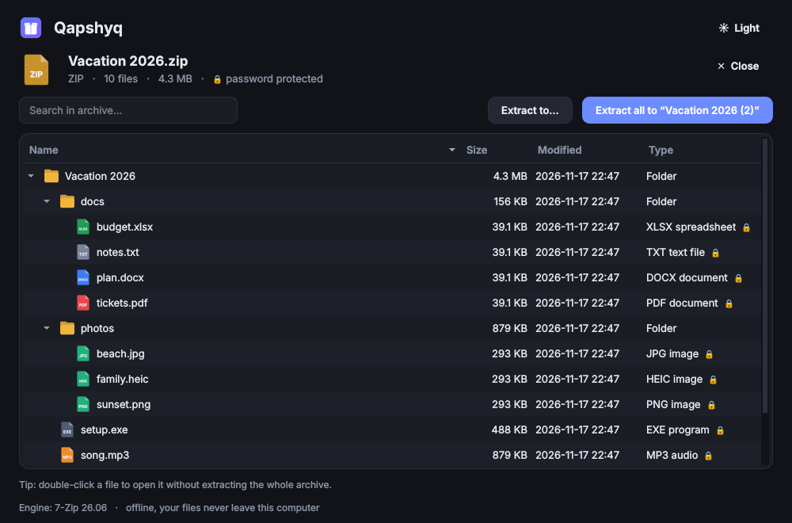
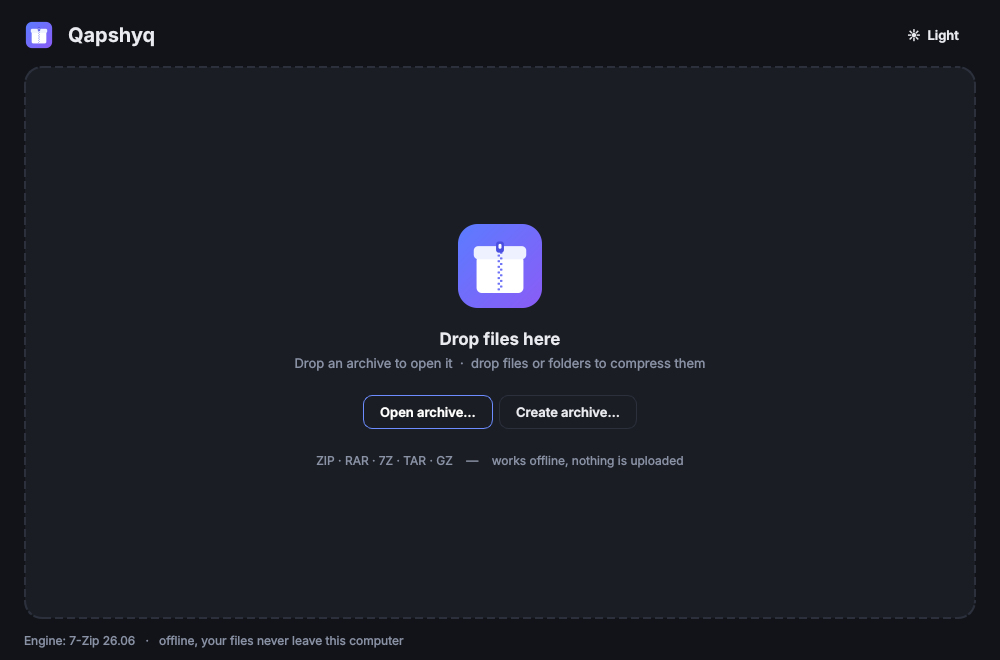
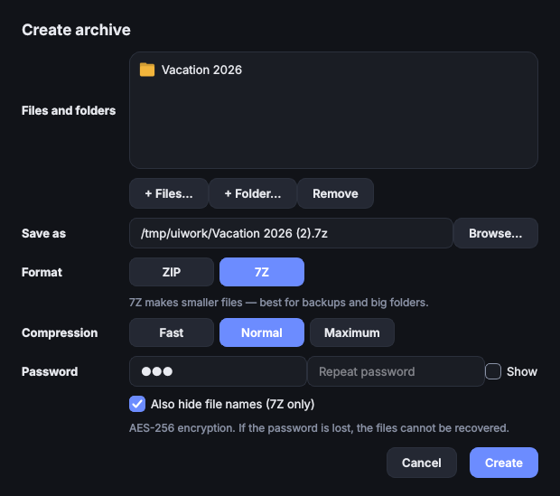
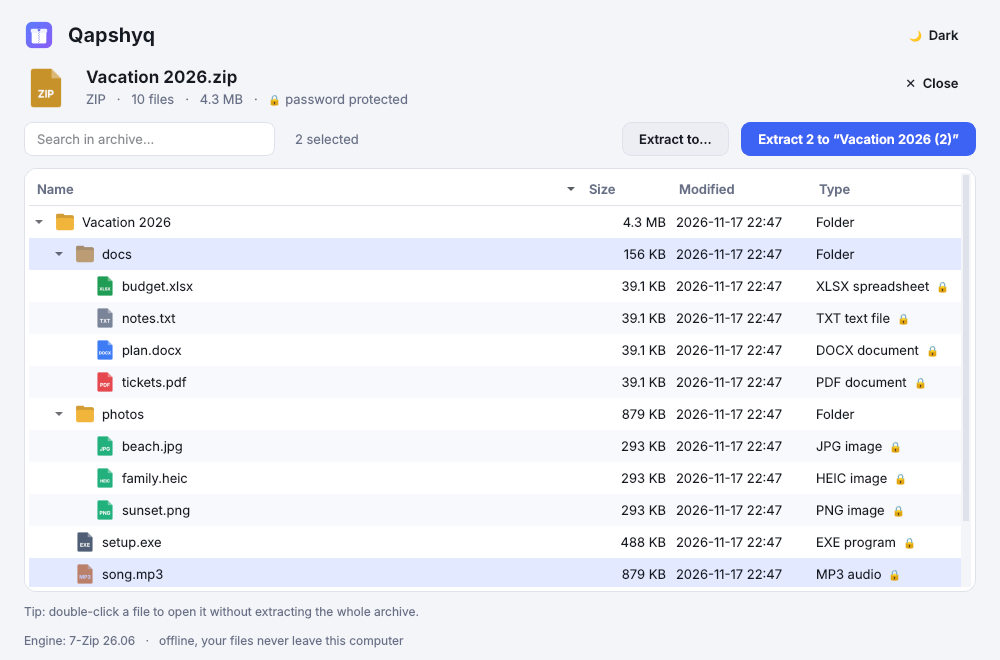

# Qapshyq

**A modern, free and private archive manager for Windows and macOS.**
Open ZIP, RAR, 7Z, TAR and GZ in one click, create ZIP/7Z with AES-256 passwords —
all offline. Your files never leave your computer.



## Features
- **Drag & drop**: drop an archive to open it, drop files or folders to compress them
- **Extract** ZIP, RAR (incl. RAR5 and multi-part), 7Z, TAR, GZ, TAR.GZ/XZ/BZ2 — everything or only selected files
- **Preview** the file list (name, size, date, type) without extracting; search inside; double-click a file to open it
- **Create** ZIP and 7Z with *Fast / Normal / Maximum* compression
- **AES-256 passwords** for ZIP and 7Z, optional hidden file names for 7Z
- **Progress bar, Cancel, clear error messages** ("The password is not correct", "The archive is incomplete"…)
- Never overwrites your files; never leaves broken half-written archives
- Blocks malicious archives that try to write outside the target folder
- **Dark and light themes**

| Home | Create | Light theme |
|---|---|---|
|  |  |  |

## Run from source
**Windows:** install [Python 3.12+](https://www.python.org/downloads/) (tick *Add python.exe to PATH*), then double-click `run_windows.bat`.
**macOS:** install [Python 3.12+](https://www.python.org/downloads/macos/), then double-click `run_mac.command`
(first time: right-click → Open).

The first start creates a virtual environment, installs PySide6 and downloads the official
7-Zip engine from 7-zip.org into `bin/`.

## Build installers
| | Command | Result |
|---|---|---|
| Windows | `scripts\build_windows.bat` (+ [Inno Setup 6](https://jrsoftware.org/isdl.php)) | `dist\Qapshyq-Setup-1.0.0.exe` |
| macOS | double-click `build_mac.command` (or `bash scripts/build_mac.sh`) | `dist/Qapshyq-1.0.0-mac.dmg` |
| Both, in the cloud | GitHub → Actions → *Build installers* → Run (or push a tag `v1.0.0`) | files under the run / Release |

## Tests
```
python -m unittest discover -s tests -v
```

## Project structure
```
main.py                     start the app
app/engine/                 archive logic (no UI): 7-Zip runner, list/extract/create, errors
app/workers/task_worker.py  runs jobs in the background (progress, cancel)
app/ui/                     window, drop zone, file tree, dialogs, themes, icons
scripts/                    setup, build and icon scripts
installer/qapshyq.iss       Windows installer (Inno Setup)
.github/workflows/build.yml automatic Windows + macOS builds
```

## Roadmap (v2)
Split archives into parts · test & repair · Explorer/Finder right-click menu ·
English / Қазақша / Монгол / Русский UI · batch extract

## License
Qapshyq: MIT. 7-Zip: GNU LGPL + unRAR restriction (RAR is extract-only). PySide6/Qt: LGPL v3.
See [THIRD_PARTY_NOTICES.md](THIRD_PARTY_NOTICES.md).
